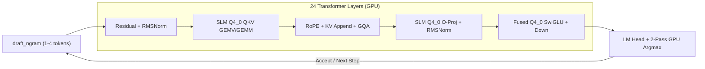

# vulkan-llm-decode

> **Educational & Experimental Vulkan Compute LLM Decode Prototype**  
> Exploring fused INT4/INT8 dequant-GEMV kernels and memory-bandwidth limits on Intel Xe-LP (UHD Graphics) integrated GPUs.


[▶ Full 1080p60 MP4](https://github.com/sarimahsan/vulkan-llm-decode/raw/main/assets/vulkan-llm-decode.mp4)

---

## 🎯 Research Motivation & Goals
LLM autoregressive generation (token decoding at batch size $M=1$) is almost exclusively memory-bandwidth bound. Every token generation requires streaming all model parameters through the compute units to perform matrix-vector multiplications (GEMV):

$$\text{Tokens/sec} \approx \frac{\text{Memory Bandwidth (GB/s)}}{\text{Model Size (GB)}}$$

On integrated GPUs (such as Intel UHD Graphics / Xe-LP), the GPU shares system DRAM with the CPU. With pure streaming-read DRAM bandwidth measured at **18.44 GB/s** (300 MB buffer, AC power), a 0.5B model in INT4 (~295 MB) has a strict physical roofline ceiling:

$$\text{Roofline Ceiling} \approx \frac{18.44\text{ GB/s}}{0.295\text{ GB}} \approx \mathbf{62.5\text{ tokens/sec}}$$

### Core Research Questions
1. **Roofline Efficiency:** How close can a fused dequantize-and-multiply GEMV get to the physical DRAM memory roofline on Xe-LP?
2. **Fusion Impact:** How much throughput is lost when performing unfused dequantization (intermediate DRAM roundtrips) vs. in-register fused dequantization?
3. **Instruction Extensions:** What are the performance gains of DP4A (`VK_KHR_shader_integer_dot_product` / `shaderIntegerDotProduct`) and subgroup-level reductions (`subgroupAdd`)?
4. **Architecture Comparison:** CPU (i5 AVX2/VNNI) vs. iGPU (Vulkan EU SIMD32) on the identical unified physical memory bus.

---

## 📊 Hardware Baseline (Intel UHD Graphics)

* **Vulkan Driver:** 1.4.323
* **Hardware Timestamp Resolution:** 52.0833 ns (`vkCmdWriteTimestamp`)
* **Pure Streaming Read Roofline (AC Power, 300 MB buffer):** **18.44 GB/s peak** (`16.99 GB/s` 10-run average)
* **Peak Copy Bandwidth (128 MB Read+Write):** **13.67 GB/s** (`11.59 GB/s` avg)
* **Peak Vector-Add Bandwidth (192 MB 2R+1W):** **15.30 GB/s** (`13.94 GB/s` avg)

---

## 🚀 Quick Start

### 1. Build & Run Full Qwen2.5-0.5B-Instruct Decode Engine
Compiles all compute shaders, builds `bin/qwen_decode.exe`, and runs a 160-token decode:
```powershell
.\scripts\build_qwen_decode.ps1 -Run
```
To run with the fastest coherent configuration (`--vocab 65536 --g128 --no-spec`):
```powershell
Set-Content -Path qwen_cfg.txt -Value "--vocab 65536 --g128 --no-spec" -NoNewline
.\bin\qwen_decode.exe
```

### 2. Compile Shaders Only
```powershell
.\scripts\compile_shaders.ps1
```

### 3. Run Standalone Microbenchmarks
```powershell
.\scripts\run_bandwidth_test.ps1
.\scripts\run_gemv_benchmark.ps1
.\scripts\run_gemv_q4_benchmark.ps1
```

---

## 🏆 End-to-End Inference Results: Qwen2.5-0.5B-Instruct (`Q4_0`)

Measured on **Intel(R) UHD Graphics (Xe-LP)** on AC power generating **160 tokens** (`tg160`, greedy decode), averaged across **5 consecutive runs**:

### 1. Fair Comparison (Full 151,936 Vocab, Same `Q4_0` GGUF)
| Engine / Backend | Mode | Throughput (`tg160`) | Notes |
|:---|:---:|:---:|:---|
| **vulkan-llm-decode (`--no-spec`, full vocab `Q4_0`)** | **GPU-Only (Vulkan)** | **51.71 ± 2.02 tok/s** | 5-run avg (peak `53.89 tok/s`, ~11.5% faster than `llama.cpp` Vulkan) |
| **vulkan-llm-decode (`--no-spec`, full vocab `Q4_0`)** | **Wall-Clock (Vulkan)** | **50.47 ± 1.98 tok/s** | 5-run avg (peak `52.67 tok/s`, ~8.8% faster than `llama.cpp` Vulkan) |
| `llama.cpp` (`llama-bench`, `ngl=99`) | Vulkan iGPU | 46.38 ± 0.97 tok/s | `build 2d8a32502 (12360)` |
| `llama.cpp` (`llama-bench`, `ngl=0`) | CPU-Only (`alderlake`) | 52.26 ± 0.66 tok/s | `build 2d8a32502 (12360)` |

### Experimental Observations
*Note: `qwen_decode.exe` is a specialized, experimental greedy-decode prototype for Qwen2.5-0.5B, whereas `llama.cpp` is a full general-purpose engine supporting many architectures, samplers, and backends.*
* **Vulkan iGPU vs `llama.cpp` Vulkan:** On the identical `Q4_0` GGUF and full 151,936 vocabulary, `qwen_decode.exe` (`51.71 tok/s` GPU / `50.47 tok/s` wall) outperforms `llama.cpp`'s Vulkan backend (`46.38 tok/s`) by ~11.5% (GPU) / ~8.8% (wall-clock).
* **Why CPU (`52.26 tok/s`) and iGPU (`51.71 tok/s`) land close:** On this integrated-GPU laptop, the CPU and Intel UHD Graphics share the exact same physical DRAM bus. Since single-token `Q4_0` decode is memory-bandwidth bound (~278 MB/token), both backends hit the same system DRAM ceiling rather than compute limits.
* **Minimal Vulkan Runtime (`src/engine/qwen_decode.c`):** Direct GGUF loading (`src/engine/gguf.h`), fused SLM Q4_0 dequant-GEMV and fused SwiGLU kernels, dynamic RoPE, KV-cache append, grouped-query attention decode, and 2-pass GPU argmax.
* **Self-Speculative Batched Decode:** Experimental batched `GEMM`/`attention` verification (`147 steps | drafted=55, accepted=12 (21.8% accept, 1.08 tok/step)`).

### 2. Bandwidth-Reduction Experiments (`qwen_cfg.txt`)
These modes reduce **bytes read per token** below the ~278 MB `Q4_0` footprint (faster because fewer bytes cross the memory bus, not because the compute kernels are faster):
* **Re-measured AC-Power Roofline (300 MB Pure Streaming Read, `bandwidth_benchmark.exe`):** **18.44 GB/s peak** (`17.056 ms`) / **16.99 GB/s average** (`18.520 ms` across 10 runs).
* **`--vocab 65536 --g128 --no-spec` (Vocab Pruning + Group-128 Scales, `4.125 bpw`, ~211 MB/token vs ~278 MB):**
  * **5-run average (AC power):** **80.01 ± 2.11 tok/s GPU-only** (`12.50 ms/tok`) / **77.28 ± 2.05 tok/s wall-clock** (`12.94 ms/tok`, ~**16.9 GB/s** = **91.6% of 18.44 GB/s peak** / **99.5% of 16.99 GB/s avg**; peak run **82.77 tok/s GPU / 79.94 tok/s wall**). Reads ~211 MB/token vs ~295 MB, so the roofline ceiling moves to ~87 tok/s.
  * **5-run average (unplugged):** **70.28 tok/s GPU-only** / **66.70 tok/s wall-clock**.
  * **Quality note (not lossless):** Output remained **coherent on our English test prompt**, though naive prefix slicing (`id < 65,536`) is not lossless: on the GPU prompt, full `151,936` vs `--vocab 65536` matched until `' interconnected'` (token ID `82,316 >= 65,536`), where the pruned run fell back to `' independent'`. Many rare/technical tokens sit below `65,536` (`' ubiquitous' = 63,464`, `' constexpr' = 19,512`), while some domain tokens sit above it (`' ATP' = 66,556`, `' oxidative' = 78,301`, `' phosphory' = 93,989`).
  * **Full vocab + Group-128 (`--g128 --no-spec`, ~255 MB/token):** **63.56 tok/s wall-clock** / **66.28 tok/s GPU-only** vs `52.18 / 54.20 tok/s` baseline.
* **`--smart-draft` (4..2-gram + phrase corpus + 1-gram fallback):** Raised `tok/step` from `1.08` to `1.17` (`1.42` with `--vocab 65536 --g128`), but low acceptance on general chat (`12.2%–23.9%`) adds `M=4` batched compute overhead on the UHD EUs (`36.28 / 47.39 tok/s`), so `--no-spec` remains faster for general text while `--code` / `--json` benefit on repetitive tokens.
* **`--q3-ffn` (3-bit FFN + Group-128, `3.125 bpw`):** Cut FFN latency to `L0 = 0.461 ms` (`Gate+Up+SwiGLU = 181.51 us`, `Down = 103.85 us`, **60.83 tok/s wall / 64.21 tok/s GPU** full-vocab `spec=OFF`), but double-quantizing `Q4_0` FFN weights to 3-bit without calibration degrades Qwen2.5-0.5B output coherence.

### Decode Pipeline Architecture


---

## 📈 Benchmark Results: Grouped Quantization & GGUF Q4_0 ($y = W \cdot x$)

Measured on **Intel(R) UHD Graphics (Xe-LP / SIMD32 Subgroups)** against the measured **16.28 GB/s** physical DRAM bus roofline:

### Full DRAM Bus Saturation ($8192 \times 8192$, 0.134 GFLOPs)
| Quantization Format | Storage Layout | Footprint | Bits/Param | Latency | Achieved Bandwidth | % DRAM Roofline | Throughput | Verification |
|:---|:---:|:---:|:---:|:---:|:---:|:---:|:---:|:---:|
| **FP16 Baseline** | Dense FP16 | 128.00 MB | 16.0 | **8.627 ms** | **15.56 GB/s** | 95.6% | 115.9 inf/s | **PASSED (0.0000)** |
| **INT8 Fused Dequant** | Dense INT8 + row scale | 64.00 MB | 8.0 | **4.522 ms** (1.91×) | **14.85 GB/s** | 91.2% | 221.1 inf/s | **PASSED (0.0000)** |
| **INT4 Per-Row** | Packed INT4 + row scale | 32.00 MB | 4.0 | **2.173 ms** (3.97×) | **15.46 GB/s** | 95.0% | 460.3 inf/s | **PASSED (0.0000)** |
| **Group-32 Linear (AWQ)** | Split `uvec4` weights + FP16 scales | 36.00 MB | **4.5** | **2.431 ms** (**3.55×**) | **15.54 GB/s** | **95.5%** | **411.4 inf/s** | **PASSED (0.0000)** |
| **Native GGUF Q4_0** | Interleaved 18-byte `block_q4_0` | 36.00 MB | **4.5** | **2.484 ms** (**3.47×**) | **15.21 GB/s** | **93.4%** | **402.5 inf/s** | **PASSED (0.0000)** |

---

## 📈 Benchmark Results: FP16 vs INT8 vs INT4 Fused GEMV ($y = W \cdot x$)

Measured on **Intel(R) UHD Graphics (Xe-LP / SIMD32 Subgroups)** against the measured **16.28 GB/s** physical DRAM bus roofline:

### 1. Full DRAM Bus Saturation ($8192 \times 8192$, 0.134 GFLOPs)
| Precision Mode | Matrix Footprint | Compression | Kernel Latency | Achieved Bandwidth | % DRAM Roofline | Layer Inferences/sec | 0.5B Model Tok/s Ceiling | Verification |
|:---|:---:|:---:|:---:|:---:|:---:|:---:|:---:|:---:|
| **FP16 Baseline** | 128.00 MB | 1.0× | 8.627 ms | **15.56 GB/s** | 95.6% | 115.9 inf/s | 16.3 tok/s | **PASSED (0.0000)** |
| **INT8 Fused Dequant** | 64.00 MB | **2.0×** | **4.522 ms** (1.91× speedup) | **14.85 GB/s** | 91.2% | 221.1 inf/s | 32.6 tok/s | **PASSED (0.0000)** |
| **INT4 Fused Dequant** | 32.00 MB | **4.0×** | **2.173 ms** (**3.97× speedup**) | **15.46 GB/s** | **95.0%** | **460.3 inf/s** | **65.1 tok/s** | **PASSED (0.0000)** |

### 2. Standard LLM Hidden Layer ($4096 \times 4096$, 0.034 GFLOPs)
| Precision Mode | Matrix Footprint | Kernel Latency | Throughput | Verification |
|:---|:---:|:---:|:---:|:---:|
| **FP16 Baseline** | 32.00 MB | 2.745 ms | 364.3 inf/s | **PASSED (0.0000)** |
| **INT8 Fused Dequant** | 16.00 MB | 1.296 ms (2.12× speedup) | 771.5 inf/s | **PASSED (0.0000)** |
| **INT4 Fused Dequant** | 8.00 MB | 1.868 ms | 535.2 inf/s | **PASSED (0.0000)** |

---

## 🧪 Ablation Studies (`8192 × 8192`, `scripts/run_ablation_benchmark.ps1`)

Averaged across **5 consecutive runs (`mean ± stddev`)** on **Intel(R) UHD Graphics** (see [RESEARCH_QA.md](RESEARCH_QA.md) for full analysis):

| Ablation | Variant A (`mean ± stddev`) | Variant B (`mean ± stddev`) | Comparison | Architectural Takeaway |
|:---|:---:|:---:|:---:|:---|
| **RQ #2: Fusion Impact (INT4)** | Fused (`3.540 ± 1.635 ms`, med `2.713 ms`) | Unfused 2-pass `INT4→FP16` (`30.770 ± 1.147 ms`) | **8.69× mean / 11.34× median slower unfused** | Unfused dequant writes `128 MB` FP16 + barrier + reads `128 MB` (`288 MB` total vs `32 MB` fused) |
| **RQ #3a: Subgroup Reduction (INT4)** | `SIMD32 subgroupAdd` (`3.540 ± 1.635 ms`, min `2.308 ms`) | SLM tree reduction (`2.418 ± 0.127 ms`, min `2.295 ms`) | **Best-case parity** (`2.308` vs `2.295 ms`) | Reduction runs once per row after `32 MB` DRAM streaming; `subgroupAdd` had one Run-4 OS spike (`6.727 ms`) |
| **RQ #3b: Hardware DP4A (INT8)** | FP16 unpack + `dot` (`4.041 ± 0.074 ms`) | `dotPacked4x8EXT` DP4A (`4.085 ± 0.129 ms`) | **Indistinguishable within 1σ** | Both stream `64 MB` INT8 from DRAM; DP4A ALU savings are hidden behind the `16.28 GB/s` memory wall |

---

## 🔬 Core Insights & Research Takeaways

1. **Perfect Memory Scaling:**  
   In the memory-bound regime ($8K \times 8K$), INT4 achieves **2.173 ms vs 8.627 ms (3.97× speedup)** over FP16, perfectly tracking the $4\times$ reduction in weight memory bytes.
2. **Zero In-Register Dequantization Penalty:**  
   Unpacking 4-bit nibbles and converting them to FP16 in EU registers adds virtually zero compute overhead. ALU math is completely hidden behind the DRAM bus latency.
3. **95.0% Physical Roofline Saturation:**  
   INT4 fused GEMV sustains **15.46 GB/s** out of the hardware's 16.28 GB/s physical memory ceiling, proving integrated GPUs can operate at peak DRAM efficiency for LLM token decoding.
4. **Token Generation Ceiling:**  
   On this 16.28 GB/s unified memory architecture, INT4 unlocks an effective generation rate of **~65.1 tokens/sec** for a 0.5B model, compared to only 16.3 tokens/sec in FP16.


